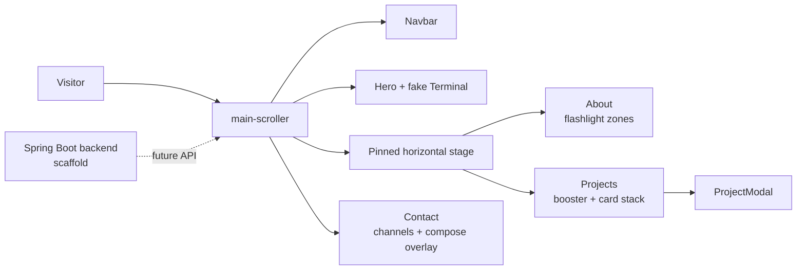

# byalina.dev

A personal portfolio site I built for myself as an L3 computer science student looking for a software engineering internship. The site is a single-page, highly interactive experience with a cozy "enchanted pond meets developer terminal" aesthetic: dark green water, rose and gold glows, handwritten-style accents, and a JetBrains Mono terminal theme.

The project lives in two parts:

- **`frontend/`** — the actual portfolio: React components, CSS, and GSAP animations.
- **`backend/`** — a Spring Boot starter that is ready to grow into a real API later. It is not required to run the site right now.

## What the site does

- **Hero** — an animated character-by-character title, skill marquee, intro, call-to-action buttons, mouse parallax glows, and a fake terminal that actually accepts `help`, `about`, `skills`, `stage`, and `clear`.
- **Navigation** — a fixed navbar that highlights the section you are in using `IntersectionObserver` and scrolls to the right place. Because the middle part of the page is a pinned horizontal animation, scrolling to "about" or "projects" uses the GSAP ScrollTrigger positions instead of a plain element offset.
- **Horizontal stage** — vertical scrolling is converted into a horizontal pan between the About and Projects panels. A custom snap-to-section effect commits to the nearest section after scrolling pauses.
- **About** — three clickable zones ("My Studies", "My Skills", "Who I Am"). On desktop, a flashlight mask follows the mouse using CSS custom properties, and clicking one zone highlights it while dimming the others.
- **Projects** — a Pokémon-style "booster pack" you open by dragging a slider, followed by a burst animation and a 3D card stack. Each card opens a detail modal with the project's role, stack, and features.
- **Contact** — ripple and "drizzle" effects when you tap the water, plus cards for GitHub, CV download, email, and LinkedIn. The mail card opens a compose overlay that builds a `mailto:` link with a subject and template body.
- **Responsive behavior** — layouts collapse from two columns to one, the navbar compacts, the flashlight is disabled on touch/small screens, and spacing shrinks on short viewports.



## Languages, libraries, and tools I used

| Category | What I used | What it was for |
| --- | --- | --- |
| Markup | **HTML5**, **JSX** | Page shell in `index.html`, plus component markup inside `.jsx` files |
| Styling | **CSS3** | Flexbox, Grid, absolute/fixed positioning, `clamp()`, custom properties, masks, gradients, transforms, `perspective`, media queries |
| Core language | **JavaScript (ES modules)** | State, events, timers, `ref`s, `getBoundingClientRect`, `IntersectionObserver`, scroll math |
| UI library | **React 19** | Components, props, `useState`, `useEffect`, `useRef`, conditional rendering, keys in lists |
| Build tool | **Vite 8** | Dev server with HMR, production build, preview server |
| Animation | **GSAP 3** + **ScrollTrigger** | Timelines, `quickTo`, staggered entrances, pin/scrub scrolling, burst effects |
| Backend | **Java 25**, **Spring Boot 4.1**, **Maven wrapper** | A separate starter application prepared for future backend features |
| Quality | **ESLint 10** with React Hooks / React Refresh plugins | Catching mistakes and enforcing consistent React code |
| Assets | **Inline SVG**, **Google Fonts (JetBrains Mono)**, `favicon.svg`, CV PDF | Icons, illustrations, typography, and downloadable resume |
| Workflow | **npm**, **Git/GitHub**, browser dev tools, Markdown + Mermaid diagrams | Installing dependencies, version control, debugging layout/animation, documenting components |

The portfolio cards also mention other projects (a Java/JDBC/SQL Cluedo game and a Node/Express/MongoDB blog), but those are content shown inside this site, not the stack used to build it.

## What this project taught me

Before this project, my HTML/CSS and vanilla JavaScript knowledge was honestly very weak. I knew the names of things, but I could not confidently build a full page from scratch. Building this portfolio taught me:

1. **HTML is more than divs.** Choosing a `button` for an action, an `a` for navigation/download, and proper headings, labels, and `aria` attributes actually matters for behavior and accessibility.
2. **CSS has a mental model.** Flexbox vs Grid, the box model, stacking contexts, `z-index`, absolute positioning inside the right parent, and `clamp()` for fluid typography all clicked only after I used them on real sections.
3. **Vanilla JS is still underneath React.** Most of the hard parts here were plain DOM work: measuring rectangles, normalizing mouse coordinates, adding and removing event listeners, clearing timers, and computing scroll positions. React did not replace that knowledge; it organized it.
4. **Components are a way to think, not just a file structure.** Splitting the page into `Hero`, `Navbar`, `About`, `Projects`, `ProjectModal`, `Contact`, and `Terminal` made each effect easier to reason about and debug.
5. **State, effects, and refs have different jobs.** State drives what the user sees; refs hold DOM nodes and values that should not trigger re-renders; effects connect to the outside world and must clean up after themselves.
6. **Animation needs choreography.** GSAP timelines, staggers, and easing made motion feel intentional, while `ScrollTrigger` taught me how scroll position can drive an animation with a custom scroller, pinning, and scrubbing. I also learned to dispatch a custom event (`projects:enter`) instead of pushing animation state through every React render.
7. **Responsive design is a set of decisions, not one breakpoint.** A flashlight effect that feels magical with a mouse is useless on a phone, so it has to be removed for touch devices. Autofocusing the terminal looked fine on desktop but jumped the mobile hero, so clicking the wrapper now focuses the input instead.
8. **Tooling is part of the job.** `npm run dev`, `npm run build`, `npm run lint`, and `npm run preview` became normal parts of my workflow. The Maven wrapper gave me the same kind of reproducible setup on the Java side.
9. **Documentation helps me think.** Writing one Markdown file per component in [`frontend/docs/`](frontend/docs/README.md), including Mermaid diagrams, forced me to explain my own architecture clearly and notice weak spots.

The biggest lesson: I do not need to memorize every CSS property or GSAP method. I need to understand the underlying model well enough to break a visual idea into small pieces, build them one at a time, and debug them calmly.

## Running it locally

You need **Node.js + npm** for the frontend. Java 25 is only needed if you want to run the backend scaffold.

```powershell
cd frontend
npm install
npm run dev
```

Then open the local URL printed by Vite (usually `http://localhost:5173`).

| Command | What it does |
| --- | --- |
| `npm run dev` | Starts the Vite dev server with hot reload |
| `npm run build` | Creates a production build in `frontend/dist/` |
| `npm run preview` | Serves the production build locally |
| `npm run lint` | Runs ESLint over the frontend |

To start the backend separately:

```powershell
cd backend
.\mvnw.cmd spring-boot:run
```

On macOS/Linux, use `./mvnw spring-boot:run` instead. The frontend does not currently call the backend, so the site works without this step.

## Project structure

```text
.
├── README.md                 # This overview
├── backend/                  # Spring Boot starter (Java 25, Maven wrapper)
│   └── src/main/java/...     # BackendApplication.java
└── frontend/
    ├── index.html            # HTML shell, font, favicon, title
    ├── package.json          # Scripts and dependencies
    ├── agents.md             # Development/documentation directives
    ├── docs/                 # Component documentation + Mermaid diagrams
    ├── public/               # Favicon, icons, CV PDF
    └── src/
        ├── main.jsx
        ├── App.jsx           # Scroller, navbar wiring, GSAP stage, snap logic
        ├── App.css
        ├── index.css
        ├── Navbar.jsx
        ├── Hero.jsx
        ├── Terminal.jsx
        ├── About.jsx
        ├── Projects.jsx
        ├── ProjectModal.jsx
        └── Contact.jsx
```

Each component has its own `.jsx`/`.css` pair where needed, and deeper technical notes are in [`frontend/docs/`](frontend/docs/README.md).
