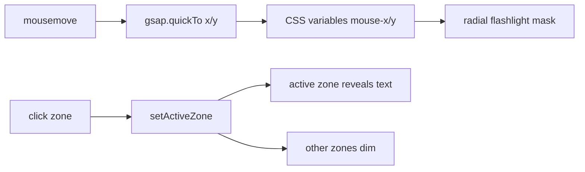

# About

The first panel of the horizontal stage. It renders a dark pond with three clickable zones: My Studies, My Skills, and Who I Am.

## Desktop interaction

- `.enchanted-pond-container` is a full-viewport section with `cursor: none`.
- Pointer movement updates `--mouse-x` and `--mouse-y` through `gsap.quickTo`, driving a radial mask on `.flashlight-reveal-layer`.
- `.lantern-cursor` follows the pointer.
- Clicking a zone toggles `activeZone`. The clicked zone expands its `.zone-text`; other zones get the `dimmed` class.

## Layout variants

| Viewport | Layout |
| --- | --- |
| `>= 1500px` | Base layout: 350px zones at 15% / 50% / 85% |
| `901px - 1499px` | Fluid width `min(350px, 22vw)` keeps zones from overlapping |
| `<= 900px` | Zones stack in a centered flex column; mask is removed, lantern hidden, normal cursor restored |
| `<= 900px` and height `<= 700px` | Smaller icons, titles, and text; container can scroll |

On small screens the flashlight effect would hide everything outside a 230px circle and touch devices have no pointer to move, so the mask is disabled and all zones stay visible. The container can scroll vertically if the stacked content does not fit.
