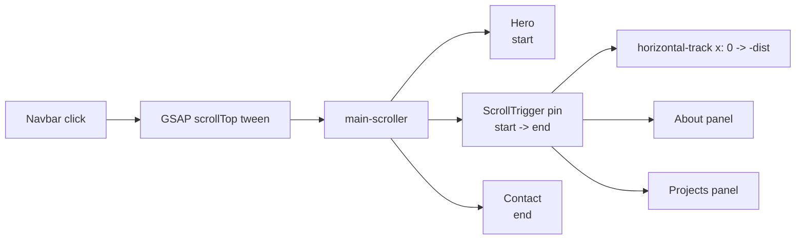

# App

The root component. It renders the fixed `Navbar`, the `Hero` section, the pinned horizontal stage (`About` and `Projects`), and `Contact` inside a single scroll container: `#main-scroller`.

## Scroll model

`html` and `body` are locked; `#main-scroller` owns all vertical scrolling. GSAP ScrollTrigger pins `.horizontal-stage` and translates `.horizontal-track` horizontally while the user scrolls vertically through that pinned range.

## Why there is no JS snap-to-section

The previous version watched the `scroll` event, waited 150 ms, then called `scrollTo({ behavior: 'smooth' })` to force the next section. That fought with ScrollTrigger's own `scrub` smoothing, so two animation systems were moving the same scroll position. It also snapped from any point in the horizontal stage straight to its end, which made the pan feel like it jumped.

Now the scroll position is left alone during normal scrolling. Navbar clicks use one GSAP tween of `container.scrollTop` with `overwrite: true`, so there is a single source of motion and no timer-driven snap.

## Straight-line movement

The panels are sized as `50%` of the `200%`-wide track instead of `100vw`. One panel is therefore exactly one stage width, which removes the scrollbar-width mismatch that made the incoming panel drift. `overflow-x: hidden` keeps 3D children from creating a horizontal scroll, and the `perspective` used by the card stack now lives on `.card-stack-wrapper` instead of the whole Projects panel, so the sliding panel itself has no 3D projection applied.

## Tuning

| Setting | Value | Effect |
| --- | --- | --- |
| `scrub` | `0.35` | Smooths wheel/trackpad steps without the long floaty lag of `0.5` |
| `pinType` | `fixed` | Pins on whole pixels, avoiding a 1px background flash at the top/bottom during the pan |
| `anticipatePin` | `1` | Reduces the hitch when the pin engages |
| `invalidateOnRefresh` | `true` | Recalculates the horizontal distance after resize/font changes |
| `overscroll-behavior-y` | `none` | Stops browser rubber-banding at the ends of the scroller |
| `100dvh` fallback | heights in `App.css`, `About.css`, `Contact.css`, `Projects.css` | Avoids viewport jumps when mobile browser chrome hides/shows |
