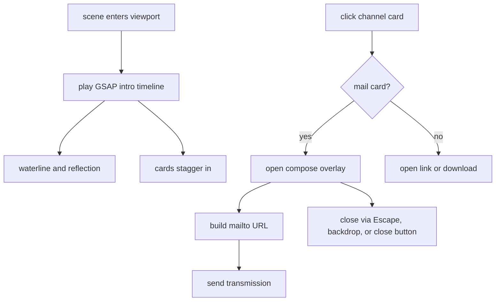

# Contact

The final full-screen section. It presents four contact channels and an email compose overlay.

## Content

| Channel | Action |
| --- | --- |
| github | Opens the GitHub profile in a new tab |
| cv.pdf | Downloads the CV file |
| mail | Opens the compose overlay |
| linkedin | Opens the LinkedIn profile in a new tab |

The waterline headline and its mirrored reflection animate in when the section enters the viewport. Clicking the scene spawns ripple and drizzle effects and swaps the hint from "tap the water" to "pick a channel".

## Compose overlay

The overlay uses `position: fixed`, `inset: 0`, and `z-index: 110` so it covers the viewport and sits above the navbar. The panel is scrollable when the viewport is short.

## Responsive layout

At `<= 900px` the scene becomes a centered flex column. The waterline, hint, cards, and closing line are all in normal flow instead of absolutely positioned. Cards use a two-column grid. Decorative glows are repositioned so they do not create phantom scroll height.

At `<= 900px` and height `<= 700px`, spacing and card sizes are reduced and the column aligns to the top; the scene can scroll if content still exceeds the viewport.
