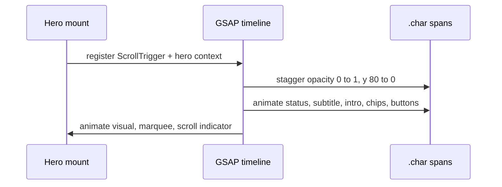

# Hero

The first full-screen section of the portfolio. It contains the introduction copy, the animated title and subtitle, call-to-action buttons, the [Terminal](Terminal.md), a scrolling skill marquee, and a scroll indicator.

## Structure

- `.hero-wrapper` is the outer grid. Two columns on wide screens, one column at `<= 960px`.
- `.hero-content` holds the status pill, title, subtitle, intro, chips, and buttons.
- `.hero-visual` holds the terminal.
- `.hero-marquee` and `.scroll-indicator` are absolutely positioned at the bottom.

## Title animation

The title is split into words, then each word into individual `.char` spans. Each word is a `.hero-word` inline block with `white-space: nowrap`, so line breaks happen only between words. The literal space between words lives outside the word spans, which keeps the rendered text as `Made byalina.dev` and prevents mid-word wrapping.

GSAP animates the `.char` elements with a staggered intro. Each character also has mouse enter/leave handlers for a small pop effect.

## Typography

`.hero-title` uses `clamp(3.2rem, 8vw, 6.6rem)` on wide screens and `clamp(2.7rem, 9vw, 4.4rem)` at `<= 960px`. Generic `.section h1`, `.section h2`, and `.section p` rules were removed from `App.css` because they overrode these values with higher specificity.

`.hero-subtitle` uses `white-space: pre` so the space between its character spans survives rendering.

## Focus behavior

The terminal input does not use `autoFocus`. On touch devices, autofocus scrolled the hero wrapper and hid the title on load. The terminal wrapper still focuses the input on click, so desktop keyboard use is unchanged.
