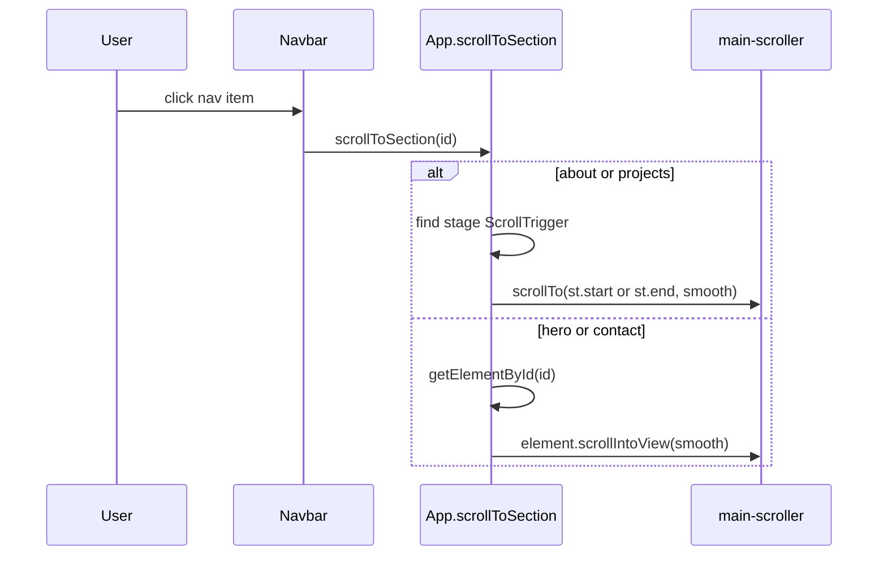

# Navbar

Fixed navigation rendered above every section. It receives `activeSection` and `scrollToSection` from `App.jsx`.

## Behavior

- Four items: `home`, `about`, `projects`, `contact`.
- The active item gets the `active` class and a one-time underline animation.
- On the hero section, `.hero-nav-list` switches link color to dark green for contrast against the light background. Elsewhere links use the cream color.
- The navbar itself has `pointer-events: none`; only the list re-enables pointer events.

## Responsive layout

At `<= 900px` the navbar is centered and compact:

- `justify-content: center`
- padding `0.9rem 1rem`
- link font size `clamp(0.95rem, 4vw, 1.2rem)`
- list gap `clamp(0.75rem, 4vw, 1.5rem)`

This keeps all four links inside narrow viewports without clipping.
