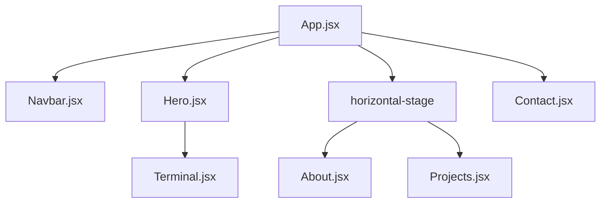

# Frontend technical documentation

Component-level documentation for the byalina.dev portfolio frontend. Each component has its own document in this directory.

## Component map

## Responsive breakpoints

| Breakpoint | Component | Behavior |
| --- | --- | --- |
| `<= 900px` | Navbar | Compact, centered navigation with clamped font size and gap |
| `<= 960px` | Hero | Single-column layout; hero wrapper can scroll vertically |
| `<= 900px` | About | Zones stack vertically, flashlight mask is removed, cursor is restored |
| `901px - 1499px` | About | Fluid zone width keeps the three absolute zones from overlapping |
| `<= 900px` | Contact | Flex column layout with a two-column card grid |
| `<= 700px` height | About, Contact | Reduced spacing, icon sizes, and text sizes for short screens |

## Documents

- [App — scroll model and nav tweens](App.md)
- [Index — HTML shell, metadata and favicon](Index.md)
- [Hero](Hero.md)
- [Terminal](Terminal.md)
- [Navbar](Navbar.md)
- [About](About.md)
- [Contact](Contact.md)
