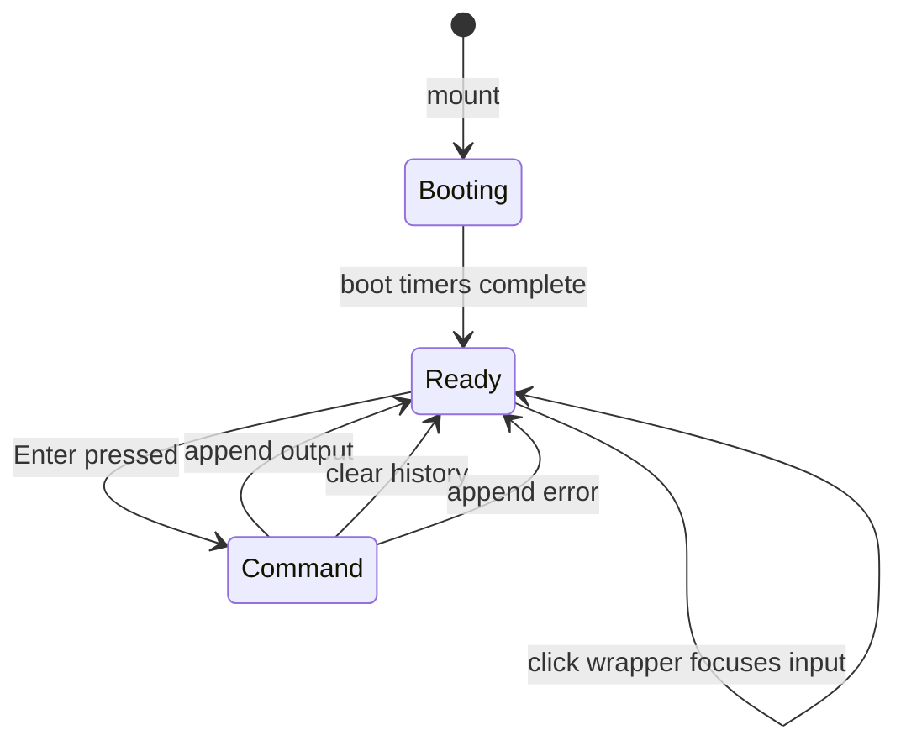

# Terminal

A fake terminal in the hero section. It boots through a short scripted sequence, then accepts a small set of commands.

## State

- `step` controls the boot sequence lines and advances at 1200 ms, 2200 ms, and 3200 ms after mount.
- `input` is the current command text.
- `history` is the list of rendered command, output, and error lines.
- `terminalBodyRef` keeps the terminal body scrolled to the bottom when `history` or `step` changes.

## Commands

| Command | Result |
| --- | --- |
| `help` | Lists available commands |
| `about` | Short introduction text |
| `skills` | Short skills list |
| `stage` | Current availability status |
| `clear` | Empties history and input |
| anything else | Error line suggesting `help` |

## Focus behavior

The input has no `autoFocus` attribute. The wrapper handles clicks and calls `focus()` on the input, so users still focus it by clicking anywhere in the terminal. This avoids the mobile hero scroll jump that autofocus caused.
